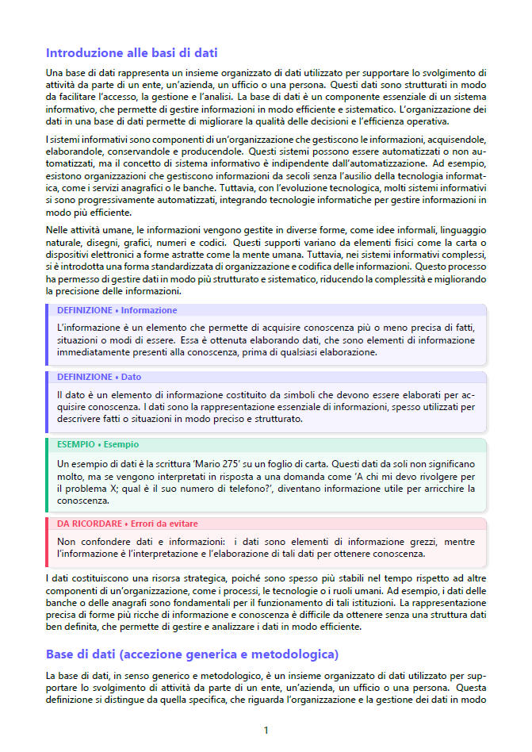

# PDFix


Trasforma appunti disordinati e imprecisi in PDF di studio ben organizzati, usando il modello Ollama [qwen3:8b](https://ollama.com/library/qwen3:8b) come "cervello" e il codice Python come le "mani" che eseguono il lavoro: l'LLM decide *cosa* dire, il codice controlla *come* viene impaginato.

<p align="center">
  
</p>

Il server lavora in modo **asincrono** e **streamma l'avanzamento** in tempo reale: l'utente vede la generazione procedere invece di aspettare al buio, e il server resta reattivo mentre lavora.

## Come funziona

1. **Server** (`server.py`) — FastAPI con due endpoint:
   - `POST /genera` — avvia la pipeline e **streamma il progresso** (`StreamingResponse`) riga per riga.
   - `GET /scarica/{nome}` — restituisce il PDF generato.

   L'input è validato con `pydantic` (`Richiesta`: `appunto` + `nome_documento`), così una richiesta malformata viene rifiutata prima di entrare nella pipeline.

2. **Client** (`client.py`) — chiede il nome del documento, invia una **POST** con `{appunto, nome_documento}` a `/genera`, legge lo stream di avanzamento man mano che arriva e, al termine, scarica il PDF da `/scarica/{nome}`.

3. **Pipeline** (`main.py`) — comunicazione asincrona con Qwen (`httpx`), suddivisione del testo in chunk, parsing e validazione del JSON, trasformazione in blocchi LaTeX e assemblaggio finale con il preambolo in `style/template.tex`.

### Il flusso, in breve

1. L'appunto viene spezzato in **chunk** (`create_chunks`) per non superare la finestra di contesto del modello.
2. I chunk vengono inviati a Qwen **in parallelo** (`asyncio.gather` / `as_completed`); l'avanzamento è streammato al client.
3. Ogni risposta JSON viene parsata e **validata**; i blocchi restano **nell'ordine del documento** grazie all'indice, a prescindere da quale chunk finisce per primo.
4. I blocchi diventano LaTeX (un template per tipo) e vengono compilati in PDF con XeLaTeX.

## Decisioni

1. **`JSON` come lista di blocchi** — niente dizionario, per evitare chiavi duplicate e garantire l'ordine dei blocchi.
2. **Il blocco** — ogni blocco ha un `tipo` che decide i campi successivi e quale **template** (funzione) lo impagina:

| Tipo | Resa nel PDF |
|------|--------------|
| `TITOLO_SEZIONE` | intestazione di sezione |
| `PARAGRAFO` | testo normale che scorre |
| `DEFINIZIONE` | box con titolo |
| `TRAP` | box "errore d'esame" |
| `ESEMPIO` | box esempio |
| `CODICE` | blocco a caratteri fissi |

3. **`costruisci_blocco()`** — scorre la lista, estrae il `tipo` e sceglie il template corrispondente, accumulando i pezzi.
4. **Blocchi non validi / tipo sconosciuto** — nonostante il prompt a Qwen sia molto specifico, il modello può restituire blocchi malformati o tipi senza senso. `valida_blocchi` controlla ogni blocco con `pydantic` e scarta (loggando) quelli non validi; `costruisci_blocco` ignora i tipi che non riconosce. In ogni caso non finiscono nel PDF.
5. **Escaping dei caratteri speciali** — ogni testo passa per una funzione di escaping prima di entrare nel LaTeX: caratteri come `%`, `_`, `&` hanno un significato speciale e, ad esempio, un `%` grezzo commenterebbe il resto della riga facendo sparire del testo senza alcun errore.
6. **Preambolo LaTeX separato** — risiede in `style/template.tex`, con un placeholder `%%CONTENUTO%%` che il codice sostituisce (`.replace()`) con i blocchi generati. Separarlo rende il PDF più facile da personalizzare.
7. **Compilazione automatica** — lanciata con `subprocess.run(["xelatex", ...])` e `-output-directory output/`, così gli intermedi (`.aux`, `.log`, `.tex`) restano in `output/` e non sporcano il progetto. Viene eseguita in un thread separato (`asyncio.to_thread`) per non bloccare il server.
8. **Asincrono + streaming** — le chiamate a Qwen usano `httpx` in modalità async così possono sovrapporsi, e il server resta reattivo; l'avanzamento è inviato all'utente via `StreamingResponse`.
9. **Nome per richiesta** — ogni PDF prende il nome scelto dall'utente, validato lato server (solo lettere, numeri e spazi) per evitare percorsi malevoli (*path traversal*).

## Requisiti

- **Python 3**
- **[Ollama](https://ollama.com/)** con il modello `qwen3:8b` scaricato (`ollama pull qwen3:8b`)
- Una distribuzione **LaTeX con XeLaTeX** (su Windows: [MiKTeX](https://miktex.org/))
- Dipendenze Python: `fastapi`, `uvicorn`, `pydantic`, `httpx`, `pytest`

```bash
pip install -r requirements.txt
```

## Come si usa

Assicurati che Ollama sia in esecuzione (`ollama serve`), poi:

**1. Avvia il server** (in un terminale, va lasciato aperto):

```bash
python -m uvicorn server:app --reload
```

**2. Invia la richiesta** (in un secondo terminale):

```bash
python client.py
```

Ti verrà chiesto il nome del documento; vedrai l'avanzamento comparire riga per riga e, al termine, il PDF viene salvato come `scaricato.pdf`.

## Test

```bash
python -m pytest
```

I test coprono le funzioni pure della pipeline (es. `create_chunks`). La **CI** (GitHub Actions, `.github/workflows/test.yml`) li esegue automaticamente a ogni push: la spunta verde sul repo conferma che il codice gira in un ambiente pulito, non solo "sul mio PC".

## Limiti noti

- **Formule matematiche non gestite** — simboli, pedici e apici (es. `T_C`, `ρ`, `∆`) non vengono ancora impaginati in modalità matematica: manca un tipo di blocco dedicato (`FORMULA`) e la relativa gestione `$...$`.
- **Generazione sequenziale su GPU singola** — i testi lunghi sono gestiti con il chunking, ma con un solo modello locale Qwen elabora i chunk in coda: il tempo cresce con il numero di chunk.
- **Errori di rete non gestiti del tutto** — se Ollama diventa irraggiungibile a metà generazione, l'errore non viene ancora comunicato in modo pulito al client.

## Possibili sviluppi

- Gestione delle formule matematiche (nuovo tipo `FORMULA`)
- Recupero mirato dei contenuti (RAG) da dispense
- Estrazione del testo da foto degli appunti (OCR)
- Retry automatico quando l'LLM restituisce JSON non valido
- Gestione robusta degli errori di rete (Ollama giù) dentro lo stream
- Interfaccia web (Streamlit)
